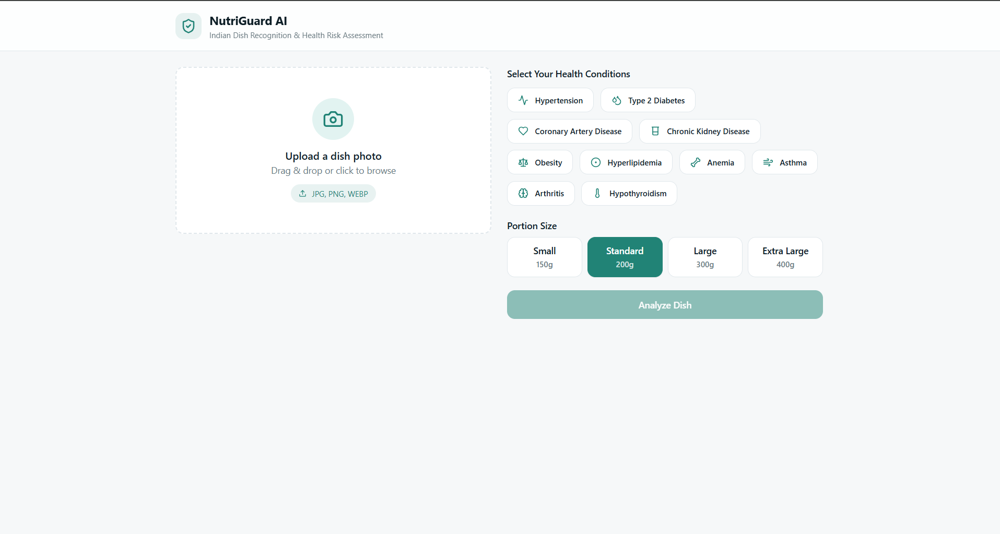
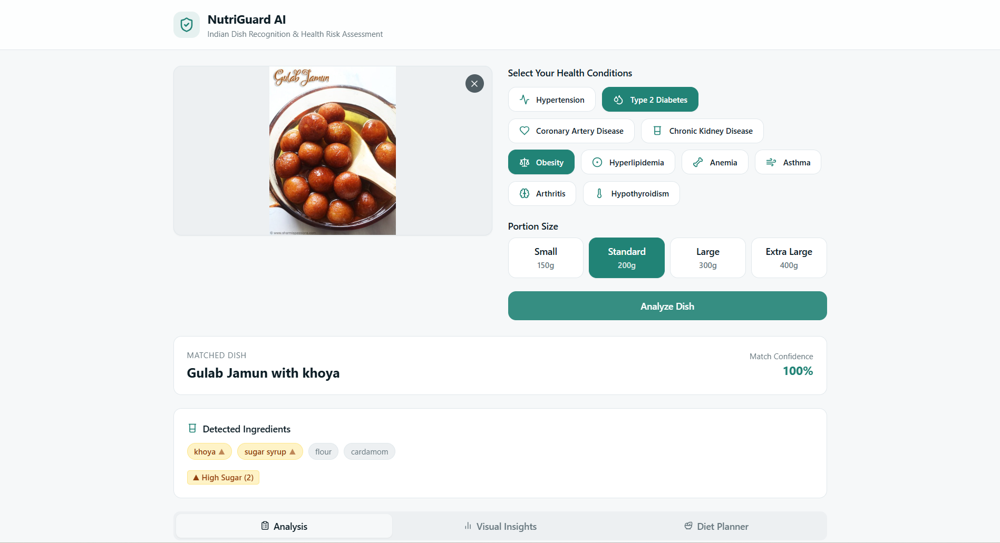
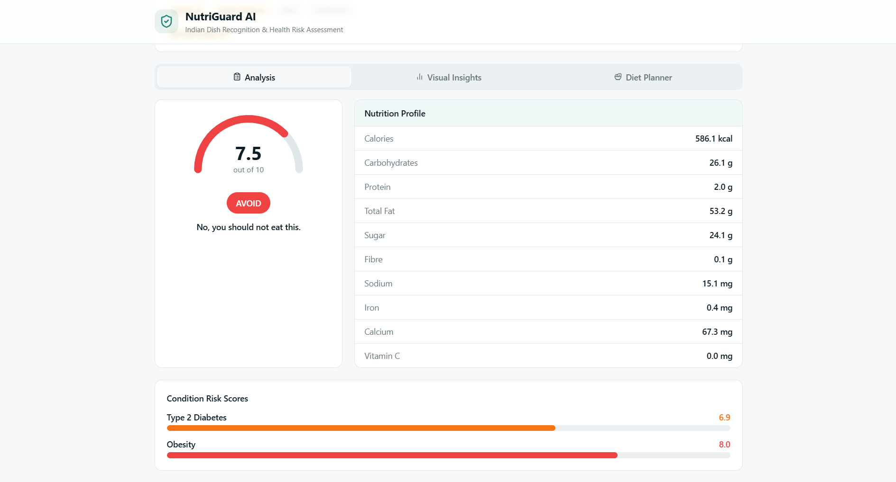
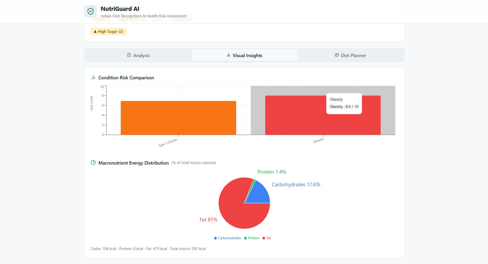
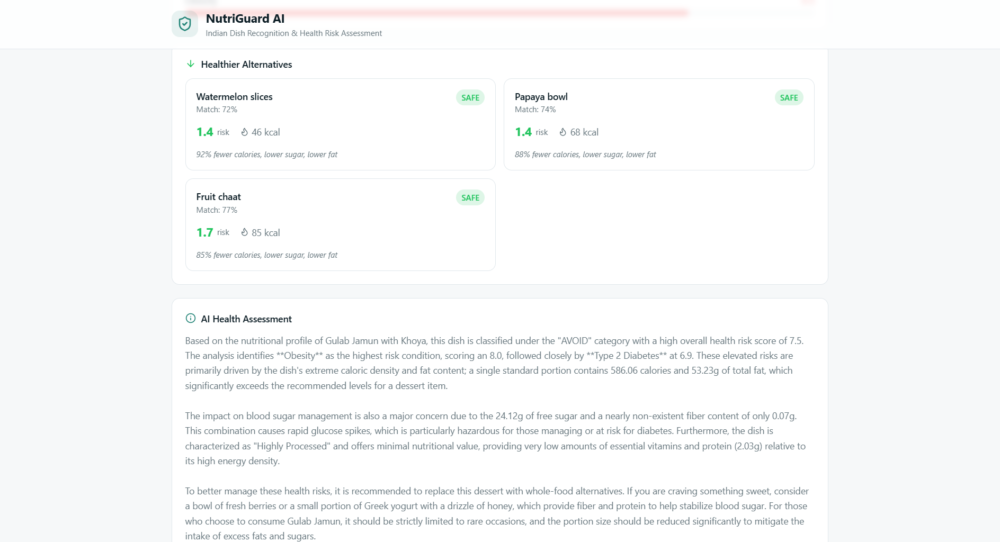
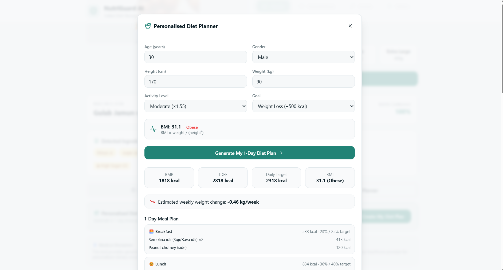
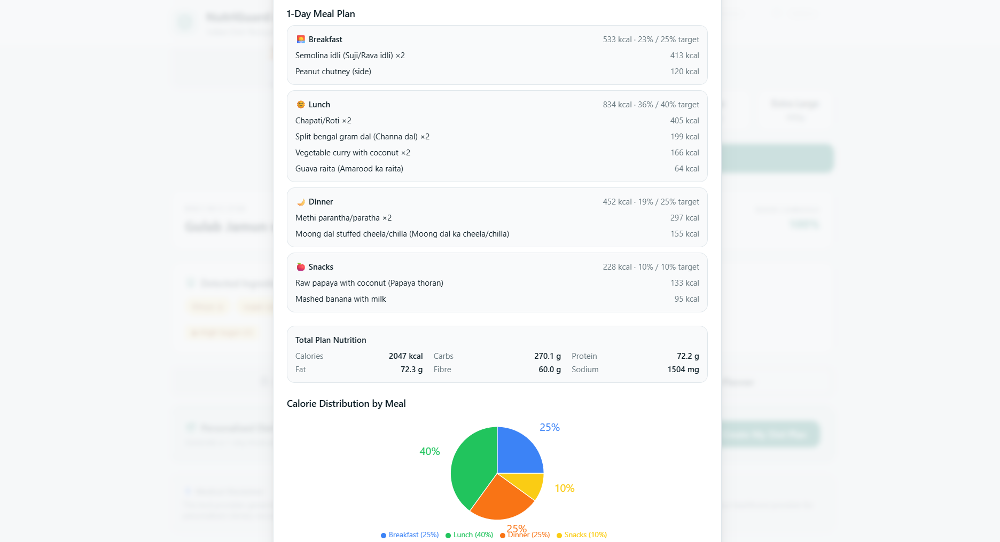
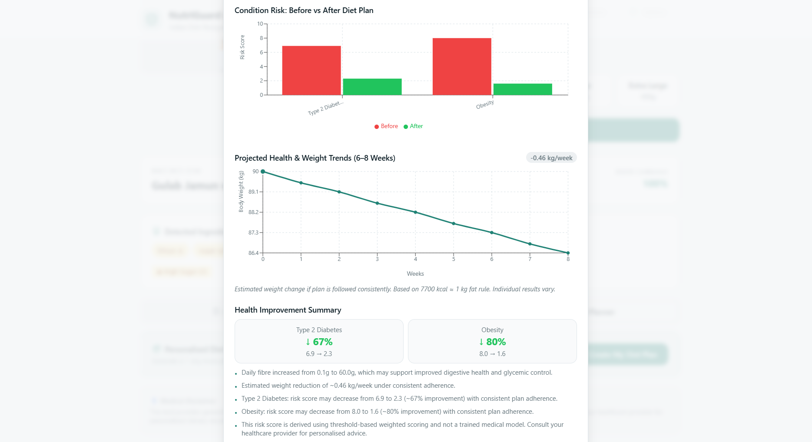

# 🥗 NutriGuard AI

### Indian Dish Recognition & Health Risk Assessment System with Intelligent Diet Planning

An AI-powered web application that recognizes Indian food dishes from images, analyzes their nutritional composition, evaluates condition-specific health risks, and generates personalized diet plans using Explainable AI techniques.

---

## 🚀 Features

- 🍛 AI-powered Indian dish recognition using **Google Gemini API**
- 📊 Nutrition retrieval from a structured Indian food dataset
- ⚠️ Condition-specific health risk assessment
- 🥗 Personalized one-day diet plan generation
- 📈 Before vs After health risk comparison
- ⚖️ 6–8 week weight projection
- 📊 Interactive visual insights and health analytics
- 💡 Explainable AI recommendations with healthier food alternatives

> **Note:** This project is developed for academic research purposes and is **not** intended to replace professional medical advice or diagnosis.

---

## 🧠 System Architecture

```
User Upload Image
        │
        ▼
Google Gemini API (Dish Identification)
        │
        ▼
TF-IDF + Cosine Similarity Matching
        │
        ▼
Nutrition Dataset Retrieval
        │
        ▼
Health Risk Scoring Engine
        │
        ▼
Diet Optimization Engine
        │
        ▼
Health Projection Module
```

---

## 🛠️ Tech Stack

| Category | Technologies |
|----------|--------------|
| **Frontend** | React, TypeScript, Vite |
| **Styling** | Tailwind CSS |
| **AI Integration** | Google Gemini API |
| **Core Logic** | Rule-Based Scoring Engine, TF-IDF, Cosine Similarity |
| **Dataset** | Indian Food Nutrition Dataset, Indian Food Image Dataset |

---

## 🩺 Supported Health Conditions

The system currently supports health risk analysis for:

- Type 2 Diabetes
- Obesity
- Hypertension

Users can select **multiple health conditions** simultaneously for a personalized assessment.

---

## 📊 Risk Scoring Methodology

Each health condition is evaluated using a weighted nutritional scoring model.

### Condition Risk

```
Condition Risk =
Σ (Normalized Nutrient × Condition Weight)
```

### Risk Levels

| Score | Category |
|-------|----------|
| 0–3 | ✅ Safe |
| 4–6 | ⚠️ Moderate |
| 7–10 | ❌ Avoid |

### Overall Health Risk

```
Overall Risk =
0.4 × Obesity
+ 0.3 × Hypertension
+ 0.3 × Diabetes
```

---

## 🥗 Personalized Diet Planning

The diet planning engine:

- Calculates **BMR** using the Mifflin–St Jeor Equation
- Computes **TDEE** using activity level
- Applies a **500 kcal calorie deficit** for weight loss
- Generates a balanced one-day meal plan

### Meal Distribution

| Meal | Calories |
|------|----------|
| Breakfast | 25% |
| Lunch | 40% |
| Dinner | 25% |
| Snacks | 10% |

The optimization engine continuously regenerates meal plans until:

```
AFTER Risk ≤ BEFORE Risk
```

---

## 📈 Health Projection

Future health improvements are estimated using:

```
7700 kcal ≈ 1 kg fat
```

The application predicts:

- Weekly weight change
- 6–8 week weight projection
- Overall health improvement summary

---

# 📸 Application Screenshots

The following screenshots illustrate the complete workflow of **NutriGuard AI**, from image upload to personalized diet generation.

### 1️⃣ Home Page



---

### 2️⃣ Dish Recognition



---

### 3️⃣ Nutrition & Risk Analysis



---

### 4️⃣ Visual Insights



---

### 5️⃣ AI Health Assessment



---

### 6️⃣ Personalized Diet Planner



---

### 7️⃣ Generated Meal Plan



---

### 8️⃣ Health Improvement Projection



---

## 🚀 Running the Project Locally

### Prerequisites

- Node.js
- npm

### Installation

```bash
# Clone the repository
git clone <YOUR_GITHUB_REPOSITORY_URL>

# Navigate to project folder
cd NutriGuard-AI

# Install dependencies
npm install

# Start development server
npm run dev
```

The application will launch with hot-reload enabled.

---

## ✨ Project Highlights

- 🇮🇳 Indian cuisine-focused nutrition dataset
- 🤖 Explainable AI architecture
- 📊 Multi-condition health assessment
- 🥗 Intelligent personalized diet generation
- 📈 Health improvement visualization
- ⚖️ Weight projection over 6–8 weeks
- 💡 Transparent and interpretable scoring methodology

---

## 📚 Academic Note

This project emphasizes **Explainable AI (XAI)** instead of black-box machine learning models.

The application enables users to understand:

- Why a dish is considered risky
- Which nutrients contribute to health risks
- How dietary modifications reduce those risks
- How personalized meal planning improves projected health outcomes